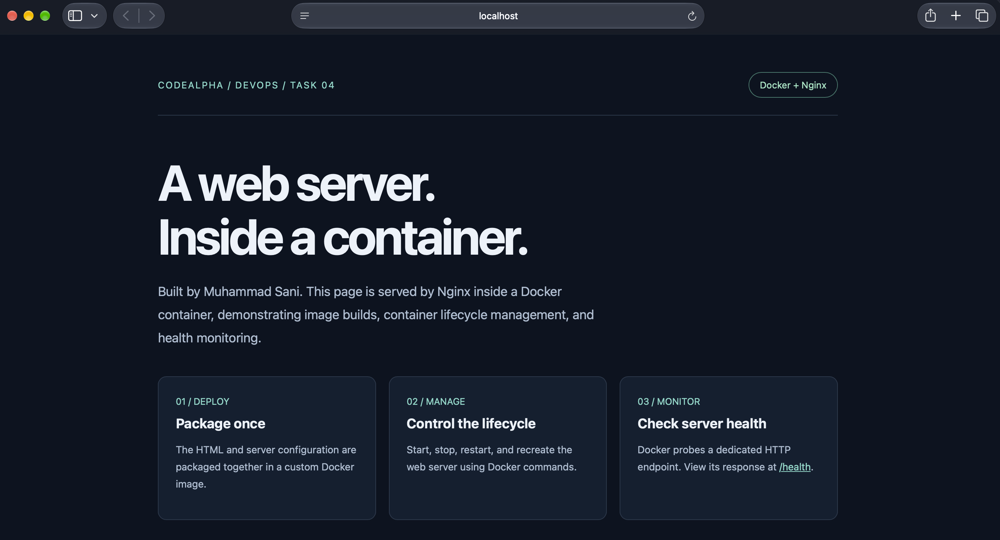
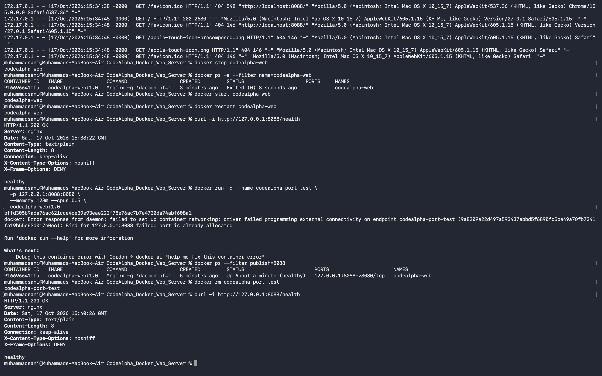

# Web Server using Docker

CodeAlpha DevOps Internship — Task 4  
Author: Muhammad Sani

## Purpose

Build and manage a containerized Nginx web server, explore its lifecycle, monitor HTTP health, and troubleshoot a controlled deployment issue.

## Implementation

- A custom HTML page served on container port 8080.
- NGINX-maintained unprivileged Alpine base image; Nginx runs as the non-root `nginx` user.
- `/health` returns HTTP 200 and `healthy` when the server is responding.
- Docker checks the endpoint every 15 seconds. This is an HTTP liveness check, not a complete application or external-network test.
- A build-context allowlist excludes unrelated files and credentials.
- The demonstrated runtime uses localhost-only publication, a 128 MiB memory limit, half a CPU, a read-only root filesystem, writable temporary space, dropped Linux capabilities, and no-new-privileges.

The base tag `stable-alpine` can change. Record the resolved base-image digest during the build if a reproducible version is required. Do not claim an immutable base version until a digest is pinned.

## Build

From this project directory:

```bash
docker build -t codealpha-web:1.0 .
```

## Run

Use host port 8088 to avoid Jenkins's port 8080:

```bash
docker run -d --name codealpha-web \
  -p 127.0.0.1:8088:8080 \
  --memory=128m --cpus=0.5 \
  --read-only --tmpfs /tmp:rw,noexec,nosuid,size=32m \
  --cap-drop=ALL --security-opt=no-new-privileges:true \
  codealpha-web:1.0
```

Open <http://localhost:8088> on the host Mac. Inside the container, the server listens on port 8080. An image build does not itself start a web server.

## Monitor and verify

```bash
curl -i http://127.0.0.1:8088/health
docker ps --filter name=codealpha-web
docker inspect --format '{{json .State.Health}}' codealpha-web
docker logs --tail 30 codealpha-web
docker stats --no-stream codealpha-web
docker exec codealpha-web id
docker exec codealpha-web nginx -t
```

Check for HTTP 200, Docker health status `healthy`, a nonzero runtime UID, and a successful Nginx configuration test. A health check marks status; it does not automatically restart an unhealthy container.

## Lifecycle demonstration

```bash
docker stop codealpha-web
docker ps -a --filter name=codealpha-web
docker start codealpha-web
docker restart codealpha-web
```

The main container was stopped cleanly (`Exited (0)`), started, and restarted. The temporary troubleshooting container was removed after its failed launch and recreated successfully with a different host port. No user data is mounted into these containers; the site is included in the image. Rebuilding the image is necessary to deploy modified site files into a new container.

## Troubleshooting: host port conflict

A second container named `codealpha-port-test` was intentionally launched with the already occupied host mapping `127.0.0.1:8088:8080`. Docker returned:

```text
Bind for 127.0.0.1:8088 failed: port is already allocated
```

`docker ps --filter publish=8088` identified `codealpha-web` as the running container using that port. The failed temporary container was removed using `docker rm codealpha-port-test`; the main website remained available and returned HTTP 200.

The second container was then recreated using host port **8089**:

```bash
docker run -d --name codealpha-port-test \
  -p 127.0.0.1:8089:8080 \
  --memory=128m --cpus=0.5 \
  --read-only --tmpfs /tmp:rw,noexec,nosuid,size=32m \
  --cap-drop=ALL --security-opt=no-new-privileges:true \
  codealpha-web:1.0
curl -i http://127.0.0.1:8089/health
```

This returned HTTP 200 and `healthy`. Both containers can listen on port 8080 internally because their host ports differ. After saving evidence, clean up only the temporary test container:

```bash
docker stop codealpha-port-test
docker rm codealpha-port-test
```

The successful test on 8089 is verified; its final cleanup has not yet been confirmed.

Browser requests for missing `favicon.ico` and Apple touch icons produced 404 entries. These were missing optional icon assets, not failures of the page or health endpoint.

## Verification status

Verified from user-supplied command output and screenshots on **October 17, 2026**:

| Check | Observed result |
| --- | --- |
| Image build | `codealpha-web:1.0` built successfully on Docker Desktop ARM64 |
| Browser website | Custom project page rendered successfully |
| Docker health | Main container reported `healthy` |
| HTTP endpoint | `/health` returned HTTP 200 with `healthy` |
| Runtime user | `uid=101(nginx) gid=101(nginx)` |
| Configuration | `nginx -t` reported successful validation |
| Resource snapshot | 8.551 MiB / 128 MiB, 0.00% CPU at one idle observation |
| Logs | Nginx startup and successful page requests visible |
| Lifecycle | Stop, start, restart, and post-restart HTTP 200 verified |
| Troubleshooting | Duplicate host port failed; changing it to 8089 returned HTTP 200 |

The observed Nginx version was 1.30.6. The build resolved the base image to:

```text
nginxinc/nginx-unprivileged:stable-alpine@sha256:782bb89768cc87b7f95c18b95baa1af250e5d451f26794f59363540161147c01
```

The Dockerfile still references the mutable tag; the digest above records this build rather than pinning future builds. Resource figures are a single observation, not a load-test result. No public hosting, TLS setup, or automatic recovery from unhealthy status is claimed.

## Screenshots





## Submission checklist

- [x] Dockerfile, Nginx configuration, and custom HTML source.
- [x] Health check, monitoring, non-root execution, lifecycle, and port-conflict resolution verified.
- [x] Website and lifecycle/troubleshooting screenshots included.
- [ ] Confirm the temporary container on port 8089 has been stopped and removed.
- [ ] Add a screenshot showing the successful port-8089 fix and monitoring results if available.
- [ ] Publish source and evidence to `CodeAlpha_Docker_Web_Server` on GitHub, including hidden `.dockerignore` and `.gitignore` files.
- [ ] Record the short demonstration and complete the internship submission steps.

## Reference

[NGINX unprivileged image documentation](https://github.com/nginx/docker-nginx-unprivileged)
